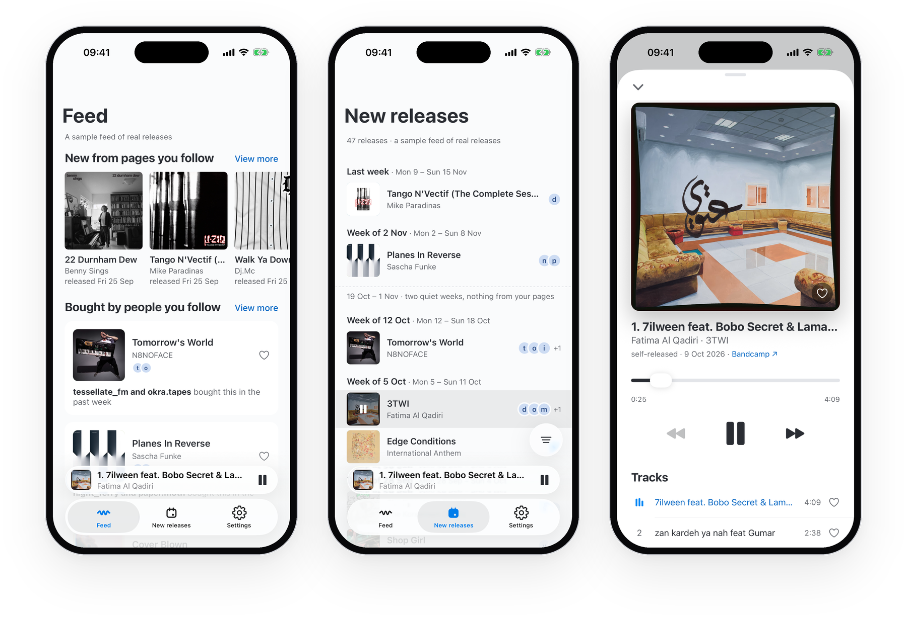

<h1 align="center">wavfeed</h1>

<p align="center"><a href="https://wavfeed.com"><strong>wavfeed.com</strong></a></p>

<p align="center">
  <a href="https://testflight.apple.com/join/saJFWAqV">
    <picture>
      <source media="(prefers-color-scheme: dark)" srcset=".github/testflight-dark.png">
      
    </picture>
  </a>
</p>

<p align="center">On Android, sign up on <a href="https://wavfeed.com">wavfeed.com</a> and you're added to the Google Play beta automatically.</p>

<p align="center">
  <picture>
    <source media="(prefers-color-scheme: dark)" srcset=".github/screenshots-dark.png">
    
  </picture>
</p>

A de-noised, filterable view of your Bandcamp activity feed, for DJs and diggers
who follow hundreds of labels and artists and lose the releases they want in the
noise. The phone app signs into Bandcamp on the phone, gathers your feed into
SQLite there, files new releases by week, and filters them by who you follow
bought them and by tag. There is no wavfeed server: your Bandcamp session and
your feed stay on the device.

## Layout

```
wavfeed-mobile/
├── CONTEXT.md     the glossary: every name in code, schema and UI copy comes from it
├── mobile/        the phone app for iOS and Android (Expo, React Native, TypeScript)
└── dev/           check.sh (the checks, as CI runs them), the pinned lint install in
                   lint/ and the migration-number checker
```

The app's opt-in usage Tallies and Error Reports go to the Tally backend, a set
of Cloudflare Workers in a private repository; `mobile/src/tally/` holds the
client and the wire contract the backend imports.

Comments cite design decisions as `ADR-NNNN`. Those design records are not
published. The code holds the mechanism, and the citation names the decision
behind it.

## Mobile

Node 22.18 or later, and npm in `mobile/`.

```sh
cd mobile
npm install
npx expo start --go      # scan the QR code with Expo Go
npm test                 # node --test over src/ and scripts/, no device needed
```

`mobile/README.md` covers the simulator and emulator rigs, the Demo, Tallies
against a local Worker, the EAS profiles, updates and releases.

## Checks

`dev/check.sh mobile`, from the repo root, runs the typecheck, oxlint, knip,
the comment and size budgets, the checker tests, and the app's tests.
`dev/check.sh --changed` runs it when your working tree touches `mobile/` or
the tooling against `origin/main`. CI runs it with `--ci`, which installs from
the lockfiles and adds the migration-number check, the fingerprint check,
`expo install --check`, expo-doctor and an `expo export`.

## Releases

The author releases from outside this repository. A release sends an EAS
Update or makes a new build per distribution (TestFlight, Play and the website
APK) from the tip of `main`, and tags what it made here; a merge to `main`
releases nothing. This repository has no self-hosted runner and no secrets:
CI runs on GitHub's hosted runners, and a pull request from a fork runs once
the author approves it.

## Contributing

Work on a branch named `feat/`, `fix/` or `docs/` and so on, run
`dev/check.sh --changed` before you open a pull request, and write conventional
commit subjects of at most 72 characters. Pull requests land by rebase, and a
pull request from a fork runs CI once the author approves it.

Every pull request agrees to the [Contributor License Agreement](CLA.md) by
ticking its box. You keep the copyright in your contribution. The agreement
lets the maintainer ship the app through the App Store and Google Play, whose
terms the AGPL alone does not allow for code by others, and it promises that
your contribution stays available under the AGPL.

## License

Copyright (C) 2026 Ellie Nieuwdorp and the wavfeed contributors.

wavfeed is free software: you can redistribute it and modify it under the
terms of the GNU Affero General Public License as published by the Free
Software Foundation, either version 3 of the License or (at your option) any
later version. It comes without any warranty. The full text is in
[LICENSE](LICENSE). SPDX: `AGPL-3.0-or-later`.

The name wavfeed and its icon are not covered by this license. A fork must use
its own name and icon.
